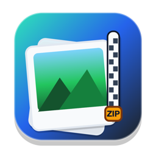
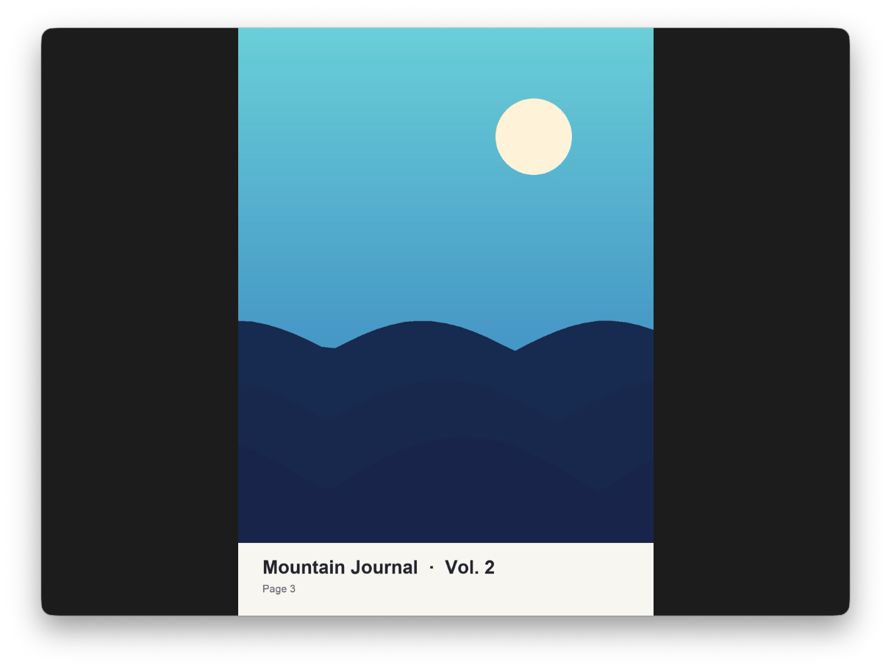
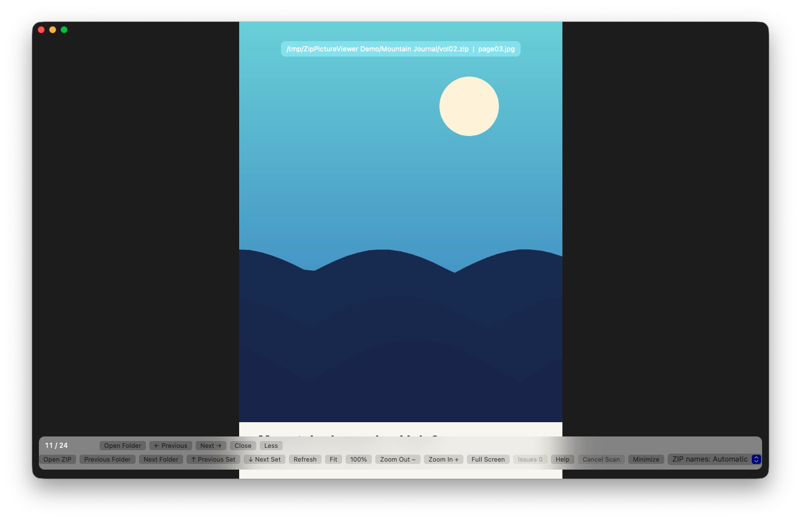
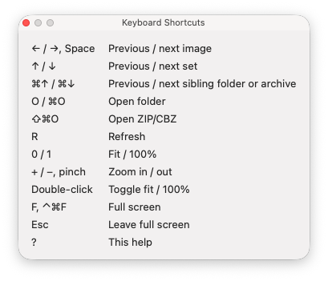
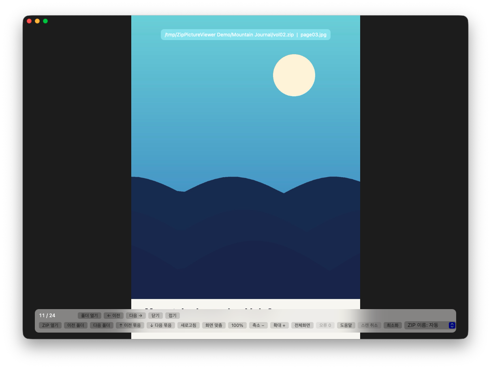
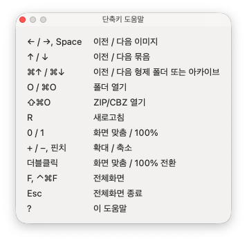

# ZipPictureViewer

**English** · [한국어](#한국어)

A native macOS viewer that pages through images in folders and ZIP/CBZ archives as one continuous stream.



---

## English

| Browsing with the controls | Keyboard shortcuts |
|---|---|
|  |  |

### Features

- Open a folder or a ZIP/CBZ by dropping it on the window, from the Open dialog, Finder's **Open With**, the Dock icon, or a command-line path.
- Opening one ZIP opens its whole folder and starts at that ZIP, so the neighbouring archives are one key away. A saved page inside that ZIP is resumed. Archives directly in your home folder or at a volume root open alone, to avoid scanning everything.
- Scans every ZIP/CBZ and image folder below the chosen folder and sorts them like Finder (`vol2` before `vol10`).
- Large or slow (external) folders show the chosen ZIP, or the one you were reading, immediately; the rest is read outward from it in the background, so ↑/↓ work right away.
- Moves by image and by set (archive or folder); the last image wraps to the first.
- Fit to window, 100%, zoom, trackpad pinch and double-click toggling. Large images are decoded at screen size, with full resolution loaded when you zoom in.
- Plays animated GIFs and honours EXIF orientation.
- A damaged image or ZIP never blocks the rest; unreadable items are listed under **Issues**.
- Detects Korean (CP949) file names in older ZIPs, with a manual override for ZIP name encoding.
- Asks for traditional ZipCrypto passwords and keeps them in memory only. AES-encrypted ZIPs are reported as unsupported.
- Remembers the last collection and the exact page, and restores them on the next launch.
- Korean and English interface: **ZipPictureViewer → 언어 (Language)** offers System Default, 한국어 and English, and switches immediately.

Supported formats: folders, `.zip`, `.cbz` (including ZIP64); images `.jpg` `.jpeg` `.png` `.gif` `.webp` `.bmp` `.heic` `.heif` `.avif` `.tif` `.tiff`. Not supported: `.rar`, `.7z`, AES-encrypted ZIP.

Safety limits: 256 MiB per uncompressed image, 100 megapixels, 500× compression ratio for ZIP members over 64 MiB, 64 MiB ZIP central directory, 100,000 ZIP members and index entries, 256 MiB image cache.

| Input | Action |
|---|---|
| `←` / `→`, `Space` | Previous / next image |
| `↑` / `↓` | Previous / next set |
| `⌘↑` / `⌘↓` | Previous / next sibling folder or archive |
| `O`, `⌘O` | Open folder |
| `⇧⌘O` | Open ZIP/CBZ |
| `R`, `⌘R` | Refresh |
| `0` / `1` | Fit / 100% |
| `+` / `-`, pinch | Zoom in / out |
| Double-click | Toggle fit / 100% |
| `F`, `⌃⌘F` | Full screen |
| `Esc` | Leave full screen |
| `?` | Keyboard shortcuts |

### Install (Release)

1. Download `ZipPictureViewer-vX.Y.Z-mac.zip` from [Releases](https://github.com/ksemperor97/ZipPictureViewer/releases), unzip it and move `ZipPictureViewer.app` to `/Applications`.
2. Builds that are not notarized are blocked the first time. Open **System Settings → Privacy & Security** and click **Open Anyway**, or run:

   ```bash
   xattr -dr com.apple.quarantine /Applications/ZipPictureViewer.app
   ```

### Requirements

- macOS 13 or later, Apple Silicon or Intel (universal app)
- To build: Swift 6 (Xcode 16 or later; Command Line Tools can build a single architecture)

### Build from source

```bash
swift run ZipPictureViewer
```

Pass a path to open it directly:

```bash
swift run ZipPictureViewer ~/Comics/Series/vol01.zip
```

Build the app bundle and a zip for distribution (`dist/ZipPictureViewer.app`, `dist/ZipPictureViewer-v<version>-mac.zip`):

```bash
Scripts/build_app.sh
```

The default is an ad-hoc signature with the hardened runtime; set `CODESIGN_IDENTITY` to sign with a certificate. Run the app with `--smoke-test` to check decoding, ZIP scanning and session storage without opening a window. Open `Package.swift` in Xcode to develop there. The icon is drawn by `swift Scripts/make_icon.swift`.

### How it works

| Location | Role |
|---|---|
| `Sources/ViewerCore` | UI-free core: formats, natural sort, ZIP central directory, name encodings and member reading (stored/deflate/ZipCrypto), scanning, folder navigation, session |
| `Sources/ZipPictureViewer` | AppKit app: window, image canvas, ImageIO decoder and cache, scan application, controls, localization, automation channel for tests |
| `Scripts/` | App bundle build and signing, notarization, packaging, icon drawing |
| `tests/` | End-to-end tests that launch and drive the real app |

The session and settings live in `~/Library/Application Support/ZipPictureViewer/` (`session.json`, `settings.json`); `ZIP_PICTURE_VIEWER_CONFIG_DIR` points elsewhere. A corrupt file starts empty, and a failed save never interrupts viewing.

All tests are end-to-end: each one launches the app, sends real `NSEvent`s (keys, clicks) and drag-and-drop, checks rendered pixels and app state, and restarts the app where persistence matters. Windows appear briefly while they run.

```bash
python3 -m pip install -r tests/requirements.txt
python3 -m pytest -q
```

Set `ZPV_E2E_APP="$PWD/dist/ZipPictureViewer.app/Contents/MacOS/ZipPictureViewer"` to run the same scenarios against a built bundle, including a Finder-style `open -a` launch. The tests use a local (127.0.0.1) control channel that only opens when the app is started with the hidden `--automation-handshake` option and `ZIP_PICTURE_VIEWER_AUTOMATION_KEY`.

Version 2.0 is a Swift rewrite; the earlier Python/PySide6 version (macOS and Windows) remains at the `python-final` tag and uses the same session file.

---

## 한국어

여러 폴더와 ZIP/CBZ 안의 이미지를 하나의 연속된 목록처럼 넘겨 보는 macOS 네이티브 뷰어입니다.

| 조작 패널과 함께 보기 | 단축키 |
|---|---|
|  |  |

### 기능

- 폴더나 ZIP/CBZ를 창에 드롭하거나, 열기 창, Finder의 `다음으로 열기`, Dock 아이콘, 명령줄 경로로 엽니다.
- ZIP 하나를 열면 그 ZIP이 든 폴더 전체를 열고 고른 ZIP부터 보여 줍니다. 옆 ZIP으로 바로 넘어갈 수 있고, 그 ZIP 안에 저장된 위치가 있으면 거기서 이어 봅니다. 홈 폴더나 볼륨 최상위에 있는 ZIP은 넓은 스캔을 피하려고 그 ZIP만 엽니다.
- 고른 폴더 아래의 ZIP/CBZ와 이미지 폴더를 모두 스캔하고 Finder처럼 정렬합니다(`vol2` 다음 `vol10`).
- 크거나 느린(외장) 폴더는 고른 ZIP 또는 읽던 ZIP을 바로 보여 주고, 나머지는 그 ZIP에서 바깥쪽으로 뒤에서 읽습니다. 그래서 ↑/↓가 바로 동작합니다.
- 이미지 단위와 묶음(아카이브·폴더) 단위로 이동하며, 마지막 이미지 다음은 처음으로 돌아갑니다.
- 화면 맞춤, 100%, 확대/축소, 트랙패드 핀치, 더블클릭 전환을 지원합니다. 큰 이미지는 화면 크기로 줄여 디코드하고, 확대하면 원본 해상도를 불러옵니다.
- GIF 애니메이션을 재생하고 EXIF 회전 정보를 반영합니다.
- 손상된 이미지나 ZIP이 있어도 나머지는 계속 볼 수 있고, 읽지 못한 항목은 `오류` 목록에 모입니다.
- 오래된 ZIP의 한글(CP949) 파일명을 자동으로 인식하고, ZIP 이름 인코딩을 직접 바꿀 수도 있습니다.
- 전통적인 ZipCrypto 암호는 물어본 뒤 메모리에만 보관합니다. AES 암호화 ZIP은 미지원으로 표시합니다.
- 마지막으로 연 컬렉션과 정확한 페이지를 기억해 다음 실행 때 복원합니다.
- 한국어·영어 화면을 지원합니다. `ZipPictureViewer → 언어 (Language)` 메뉴에서 시스템 설정 따름, 한국어, English를 고르면 바로 바뀝니다.

지원 형식: 폴더, `.zip`, `.cbz`(ZIP64 포함), 이미지 `.jpg` `.jpeg` `.png` `.gif` `.webp` `.bmp` `.heic` `.heif` `.avif` `.tif` `.tiff`. 미지원: `.rar`, `.7z`, AES 암호화 ZIP.

안전 상한: 이미지 한 개의 비압축 크기 256MiB, 1억 픽셀, 64MiB 이상 ZIP 항목의 압축률 500배, ZIP 중앙 디렉터리 64MiB, ZIP 항목과 전체 목록 각각 10만 개, 이미지 캐시 256MiB.

| 입력 | 동작 |
|---|---|
| `←` / `→`, `Space` | 이전 / 다음 이미지 |
| `↑` / `↓` | 이전 / 다음 묶음 |
| `⌘↑` / `⌘↓` | 이전 / 다음 형제 폴더 또는 형제 아카이브 |
| `O`, `⌘O` | 폴더 열기 |
| `⇧⌘O` | ZIP/CBZ 열기 |
| `R`, `⌘R` | 새로고침 |
| `0` / `1` | 화면 맞춤 / 100% |
| `+` / `-`, 핀치 | 확대 / 축소 |
| 더블클릭 | 화면 맞춤 / 100% 전환 |
| `F`, `⌃⌘F` | 전체 화면 |
| `Esc` | 전체 화면 종료 |
| `?` | 단축키 도움말 |

### 설치 (Release)

1. [Releases](https://github.com/ksemperor97/ZipPictureViewer/releases)에서 `ZipPictureViewer-vX.Y.Z-mac.zip`을 내려받아 풀고, `ZipPictureViewer.app`을 `/Applications`로 옮깁니다.
2. 공증받지 않은 빌드는 처음 실행할 때 막힙니다. `시스템 설정 → 개인정보 보호 및 보안`에서 `그래도 열기` 버튼을 누르거나, 다음을 실행합니다.

   ```bash
   xattr -dr com.apple.quarantine /Applications/ZipPictureViewer.app
   ```

### 요구 사항

- macOS 13 이상, Apple Silicon 또는 Intel (유니버설 앱)
- 빌드하려면 Swift 6 (Xcode 16 이상, Command Line Tools로는 한 아키텍처만 빌드)

### 소스에서 빌드

```bash
swift run ZipPictureViewer
```

경로를 넘기면 바로 엽니다.

```bash
swift run ZipPictureViewer ~/Comics/Series/vol01.zip
```

앱 번들과 배포용 zip(`dist/ZipPictureViewer.app`, `dist/ZipPictureViewer-v<버전>-mac.zip`)을 만듭니다.

```bash
Scripts/build_app.sh
```

기본은 hardened runtime을 켠 ad-hoc 서명이며, `CODESIGN_IDENTITY`로 인증서 서명을 지정할 수 있습니다. `--smoke-test`로 실행하면 창 없이 디코더, ZIP 스캔, 세션 저장을 점검합니다. Xcode에서 개발하려면 `Package.swift`를 엽니다. 아이콘은 `swift Scripts/make_icon.swift`로 그립니다.

### 동작 방식

| 위치 | 역할 |
|---|---|
| `Sources/ViewerCore` | UI 없는 핵심: 형식, 자연 정렬, ZIP 중앙 디렉터리·이름 인코딩·항목 읽기(Stored/Deflate/ZipCrypto), 스캔, 폴더 탐색, 세션 |
| `Sources/ZipPictureViewer` | AppKit 앱: 창, 이미지 캔버스, ImageIO 디코더와 캐시, 스캔 적용, 조작 패널, 다국어, 테스트용 자동화 채널 |
| `Scripts/` | 앱 번들 빌드와 서명, 공증, 압축, 아이콘 그리기 |
| `tests/` | 실제 앱을 띄워 조작하는 E2E 테스트 |

세션과 설정은 `~/Library/Application Support/ZipPictureViewer/`(`session.json`, `settings.json`)에 저장하며, `ZIP_PICTURE_VIEWER_CONFIG_DIR`로 다른 폴더를 지정할 수 있습니다. 파일이 손상되면 빈 상태로 시작하고, 저장에 실패해도 감상은 계속됩니다.

테스트는 모두 E2E입니다. 테스트마다 앱을 실행해 실제 `NSEvent`(키, 클릭)와 드래그 앤 드롭을 보내고, 그려진 픽셀과 앱 상태를 확인하며, 저장 동작은 앱을 다시 켜서 확인합니다. 실행 중에는 창이 잠깐씩 나타납니다.

```bash
python3 -m pip install -r tests/requirements.txt
python3 -m pytest -q
```

`ZPV_E2E_APP="$PWD/dist/ZipPictureViewer.app/Contents/MacOS/ZipPictureViewer"`를 지정하면 빌드한 앱 번들로 같은 시나리오를 돌리고, Finder와 같은 `open -a` 실행도 확인합니다. 테스트는 앱을 숨은 `--automation-handshake` 옵션과 `ZIP_PICTURE_VIEWER_AUTOMATION_KEY`로 실행할 때만 열리는 로컬(127.0.0.1) 제어 채널을 씁니다.

2.0은 Swift로 다시 만든 버전입니다. 이전 Python/PySide6 버전(macOS·Windows)은 `python-final` 태그에 남아 있고, 같은 세션 파일을 씁니다.
